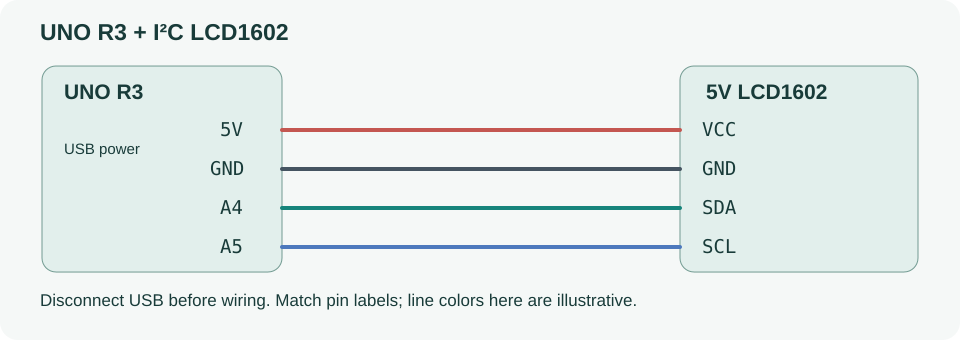
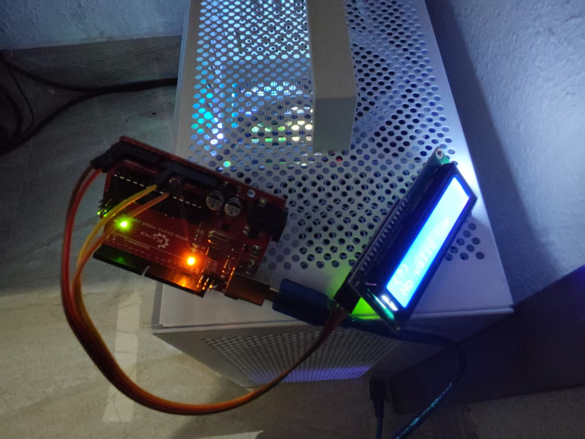
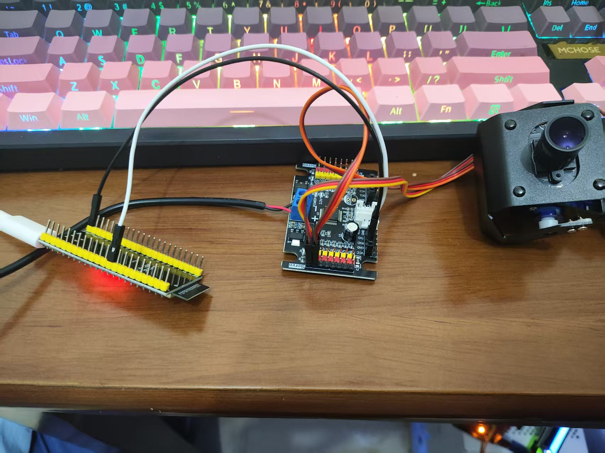

# toboo

Windows 桌面陪伴机器人原型：在一个界面中完成 AI 对话、摄像头预览、面部表情线索分析和设备管理。

**[下载最新 Windows x64 版本](https://github.com/Myoossootis/Toboo/releases/latest)** · [开始使用](docs/getting-started.md) · [开发说明](docs/development.md) · [架构](docs/architecture.md)

## 启动

下载 Release 中的 `toboo-版本号-win-x64-portable.zip`，**完整解压后双击 `toboo.exe`**。便携包自带 .NET 运行时，无需安装 SDK。

从源码运行：安装 [.NET 8 SDK](https://dotnet.microsoft.com/download/dotnet/8.0)，双击仓库根目录的 **`start-toboo.cmd`**，或执行：

```powershell
./scripts/start-toboo.ps1
```

源码主入口是 [`src/Toboo.Desktop/Program.cs`](src/Toboo.Desktop/Program.cs)，解决方案是 [`Toboo.sln`](Toboo.sln)。

## 功能与状态

| 功能 | 当前能力 |
| --- | --- |
| 陪伴对话 | 在 toboo 内输入、接收流式回复、停止生成、切换模型、管理会话；通过独立的 DeepSeek Harness 桥接插件连接模型服务 |
| 视觉 | 图片、录像和 USB 摄像头；本地 YuNet 人脸检测、目标锁定和画面标注 |
| 表情线索 | 愤怒、厌恶、恐惧、开心、中性、悲伤、惊讶七类；不确定时显示 Unknown，支持时间确认和失效清除 |
| 设备与设置 | 摄像头配置、连接状态、模型与陪伴风格；高级工作台保留视觉分析、舵机调试和传感器预览 |
| 硬件原型 | 独立 ESP32 舵机固件、UNO 传感器遥测和可复现的合成数据回放；便携版自带串口运行环境，接线和参数需按设备核对 |
| 表情屏 | [Uno + I²C LCD1602](docs/lcd.md) 实时显示有效表情、颜文字和失效状态；便携版内置串口支持，Uno 需专用固件 |
| 待接入 | 麦克风语音输入、语音输出；当前版本不将这些规划项作为已完成功能 |

面部表情分类描述可见线索，不能判断人的真实心理情绪。图像分析在本地运行；使用 AI 对话时，对话文本会交给 Harness 配置的模型服务。相机画面不会通过聊天桥自动上传，表情结果也不会自动控制执行器。

## AI 对话

先安装并配置 DeepSeek Harness 的模型服务，再安装本仓库附带的独立桥接插件。聊天界面始终在 **toboo** 中，Harness 提供后台模型连接。

源码和便携包都提供 `scripts/install-toboo-harness.ps1`。首次安装后需要从系统托盘完全退出并重新打开 Harness。完整步骤、连接文件和故障排查见 [Harness 接入](docs/harness.md)。

## 硬件连接



| LCD1602（5V I²C 版） | UNO R3 |
| --- | --- |
| GND | GND |
| VCC | 5V |
| SDA | A4 / SDA |
| SCL | A5 / SCL |

断开 USB 后接线，按模块丝印核对引脚；示意线色不代表实际线色。UNO 屏幕和 ESP32 云台分别通过各自的 USB 连接电脑，使用不同串口。

<table>
  <tr><th>UNO + LCD1602 实物</th><th>ESP32 + 驱动板 + 云台实物</th></tr>
  <tr>
    <td width="50%"></td>
    <td width="50%"></td>
  </tr>
</table>

照片按双栏排版，保留原始元件和接线。具体供电、电平和端子定义以 [硬件接口](docs/hardware.md) 与 [LCD 使用说明](docs/lcd.md) 为准，不凭照片推断隐藏针脚。LCD 仅显示表情，不触发云台运动。

## 源码布局

```text
src/
  Toboo.Desktop/     Avalonia 桌面入口、页面、视图模型和界面服务
  Toboo.Cli/         无界面的视觉实验与传感器工具
  Toboo.Core/        纯算法、状态机和数据模型
  Toboo.Vision/      OpenCV 图像处理、检测、表情推理和原生缓冲
  Toboo.Runtime/     日志、传感器回放和主机串口工具调用
tests/              算法、图像和桌面交互测试
integrations/       独立 Harness 桥接插件及其测试
firmware/           ESP32 / UNO 固件、协议和主机工具
models/             固定版本的离线模型及来源信息
scripts/            启动、验证、固件构建与发布脚本
docs/               面向使用者和贡献者的说明
```

## 开发与验证

支持 Windows x64，使用 .NET 8 CLI 和固定版本依赖。完整验证还需要 Node.js 20 或更新版本。

```powershell
dotnet restore Toboo.sln --locked-mode
dotnet build Toboo.sln -c Release --no-restore
./scripts/verify.ps1
```

验证默认使用合成输入，不驱动物理执行器。真实相机、串口、电源和机械运动需要独立测试，不能从单元测试结果推断。更多说明见 [开发与验证](docs/development.md)、[硬件接口](docs/hardware.md) 和 [贡献指南](CONTRIBUTING.md)。

## 依赖与许可

第三方组件和模型的来源、许可及再分发声明见 [THIRD-PARTY-NOTICES.md](THIRD-PARTY-NOTICES.md) 与 [`licenses/`](licenses/)。便携包也包含这些声明。仓库尚未为项目原创代码授予开源许可证；公开可见不代表可以任意再分发或商用。
