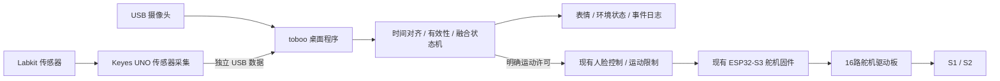

# toboo：桌面陪伴机器人的多传感器方案

## 定位与当前边界

产品正式命名 **toboo · 桌面陪伴机器人**。已有能力是本地人脸检测、双轴视觉跟随、回中心、矩形与交叉对角线检查、限位及通信故障降级预览。传感器融合是下一阶段计划，本文不表示实物已接入。

现役 S1 工作请求 30–175°，S2 50–150°，中心 (103°,100°)。S1 新舵机到货后再校准与改进响应速度。本阶段不修改控制增益、速度、固件或实际机构输出。角度始终是请求，不是轴位测量。

无人机识别保存在 `codex/archive-drone-recognition-20261109`，快照 `9c98b66`。当前产品树移除专用模型、检测/重捕获、评价工具和入口；通用 ArUco、CSRT、帧差、视频读取、日志与人脸基础设施继续复用。归档分支不再合入 main。

## 为什么这样安排更贴评分标准

本机课程指南规定：提案占课程总评 10%（内容 5%、口头表达 5%），演示 15%，报告 10%。演示评价结果、难度与视频质量；报告评价课程相关性、难度、结果与报告质量。没有给出按传感器数量加分的规则。

因此把工作量组织成 **传感原理 → 标定与噪声 → 时间对齐 → 融合判断 → 可见行为 → 对照实验**。每加一个传感器，要能回答它减少了什么误判、增加了什么可演示能力。

提案：2026-11-23 23:59 前，少于 10 页幻灯片，课堂报告少于 3 分钟。演示与报告：2026-12-19，演示视频少于 5 分钟且出现本人，报告 10–15 页。若后续课堂通知更改，以教师通知为准。先按个人项目安排；组队人数增加时，指南要求总工作量相应增加。

## 套件清单核对

依据本机 KE0084/KE0085 手册第 4、7、8 页清单及对应实验。这里确认的是手册标配，接线前仍需核对实物型号与板级电路。

| 模块 | toboo 用法 | 融合对象 | 顺序与限制 |
| --- | --- | --- | --- |
| MMA8452Q 三轴加速度 | 拿起、倾斜、摇晃感知；姿态异常暂停云台 | 云台状态、视觉会话 | 第一阶段；明确的电容式 MEMS 课程关联。不是陀螺仪，也不能提供水平舵机绝对角度 |
| TMD27713 光感/接近模块 | 环境亮度、手靠近的“摸头”交互、夜间模式 | 人脸、超声波 | 第一阶段；ALS 与 PROX 是一块器件的两种观测，不能把 PROX 原始计数直接当厘米 |
| 超声波模块 | 近距离障碍、桌面个人空间、手接近 | 光学接近、人脸框 | 第一阶段；量程和盲区实测。波束内最近物体未必是人脸，无回波应标为无效 |
| PIR 人体移动 | 有人经过时唤醒，配合视觉进入陪伴 | 人脸、光照、时间窗 | 第一阶段；感知热目标移动，不能独自证明有人静坐或已离开 |
| 声音传感器 | 拍手/声响事件唤醒、简短互动 | PIR、人脸、执行器时序 | 第二阶段；手册为模拟声音输出与增益调节例程。先做相对声强和事件，不承诺语音识别或声源方位 |
| DHT11 | 环境温湿度卡片、低频舒适度提醒 | 光照、在场状态 | 第二阶段；不用于人体测温。传感响应慢，不能按摄像头帧率重复当作新样本 |
| RC522 RFID + 卡/钥匙扣 | 刷卡选择本地陪伴偏好/访客模式 | 在场、人脸锁定 | 可选；显式卡片识别与人脸身份识别是不同功能。先确认电平接口 |
| LM35DZ | 与 DHT11 做温度交叉对照、响应曲线 | DHT11、参考温度计 | 可选；适合增加传感器标定实验，不将两路一致当作真实准确度证明 |
| 光敏电阻 ×3 | 简单照度基线、左右光线比较 | TMD ALS | 可选；与 ALS 做对照有价值，避免重复实现两个无关联仪表 |
| MQ-2 气体 | 实验性相对响应展示 | 温湿度、事件日志 | 后置；预热、功耗、环境交叉敏感与标定增加时间成本，不当作可靠安全报警器 |
| GUVA-S12SD 紫外 | 相对 UV 响应、光照对照 | ALS | 后置；室内演示信号可能弱，未经参考标定不报告准确 UV 指数 |
| 火焰红外元件、滚珠开关 | 原理对照、倾斜开关基线 | MMA8452Q | 低优先；不为演示制造明火，倾斜检测优先用加速度模块 |

套件还有摇杆、按键、红外遥控接收器、1602 LCD、8×8 点阵、RGB、蜂鸣器、DS1302、步进电机/驱动与继电器。它们可做输入、反馈或执行器；显示器、时钟、舵机不计作新增环境传感器。RGB/点阵/蜂鸣器适合低成本表达情绪；继电器和新步进机构不进入首版。

## 建议的两个交付层级

**基础完整演示：现有视觉 + MMA8452Q + TMD 光感/接近 + 超声波 + PIR，共五类模块。** 先完成可靠唤醒、看人、近手互动、拿起保护和夜间状态。

**扩展完整演示：再加入声音和 DHT11，共七类模块。** 增加拍手唤醒、温湿度展示与环境模式。RFID、LM35 的对照实验根据剩余时间加入，不阻塞基础流程。

## 六条可演示的融合行为

| 场景 | 判断过程 | 输出与需要记录的证据 |
| --- | --- | --- |
| 用户走近 | PIR 事件生成短时在场候选 → 摄像头连续确认人脸 → 陪伴跟随 | RGB/表情唤醒；记录唤醒延迟、空场误唤醒次数 |
| 用户静坐 | 已确认人脸维持陪伴；PIR 暂无运动不立即退出 | 保持注意；比较只用 PIR 与融合后的错误休眠率 |
| 手靠近“摸头” | 光学 PROX 上升 + 超声波近物；有在场证据时接受互动 | 表情/声音回应；记录不同材质、光照和距离下的误触发 |
| 拿起或放歪 | 加速度低通估计重力方向，高通/变化量检测拿起；姿态异常优先暂停运动 | 停发/保持并提示；记录触发延迟、桌面轻敲误触发与放稳恢复条件 |
| 夜间陪伴 | ALS 低亮度 + 在场/活动状态 → 降低屏幕、RGB、蜂鸣器输出；DHT 补充环境状态 | 模式变化；记录明暗切换滞回和模式反复跳变次数 |
| 拍手互动 | 声音短时能量/峰值 + 时间间隔 + 在场线索；屏蔽自身蜂鸣和舵机运动时段 | 唤醒或表情反馈；对比拍手、说话、键盘、舵机噪声的混淆情况 |

不把“没有看到脸”解释成一定无人，不把单次超声波超时解释成距离很远，不在传感器失效时伪造观测。

## 系统结构与复用

优先让现有 UNO 做独立采集板，复用厂家示例和 5V 模块接口；电脑统一融合。ESP32 现有舵机通道保持独立，避免在当前控制循环塞入阻塞式测距、DHT 读取或大量 I2C 轮询。UNO 程序需检查 Flash/RAM 占用，采用固定缓冲区与多速率调度，不能假定所有示例可直接拼在一起运行。

Core 只新增纯数据模型/融合状态机，继续无 UI/OpenCV/串口依赖；传感器串口在桌面服务层，Vision 继续管理图像；共享现有日志、单调时钟、边界、停止和故障提示。融合层输出陪伴状态和运动许可，不直接绕过舵机限位。

建议状态：休息、发现活动、陪伴、近手互动、姿态保护、环境提醒。优先级为用户停止/姿态保护 > 距离保护 > 互动 > 视觉跟随 > 休息。保护事件必须取消旧目标；放稳后不静默恢复未经确认的动作。

传感器数据带版本、递增序号、设备毫秒时间、电脑接收单调时间、有效位。按各传感器真实更新率设置新鲜度；低频 DHT 可展示最近有效值及数据年龄，快速保护不能使用过期加速度或距离。所有阈值先标为待标定，不把示例常数当成实验结论。

## 接线前要解决的两个具体问题

1. 手册第 119 页称 TMD27713，第 120 页例程却包含 `APDS9930.h`。先拍实物丝印、读 I2C 器件 ID，再确定驱动；不直接把库名当成实物型号。
2. NXP MMA8452Q 裸芯片供电为 1.95–3.6V，I2C 引脚不能按 5V 器件处理。Keyes 模块是否带稳压/电平转换需要看实物或原理图。UNO 的模块供电、总线上拉和逻辑电压确认后再接；5V 超声波/模拟输出不直接接 ESP32 GPIO。现阶段只设计，不盲接。

## 能写进报告的量化工作

- 超声波：尺量多距离、不同角度/材质，给出偏差、重复性、无效回波比例。
- 加速度：静止噪声、六面重力对照、倾斜阈值及滞回；区分重力与运动加速度，不承诺 yaw 测量。
- 光感/接近：多光照、不同手距，给出响应和触发滞回；明确原始计数与参考量的区别。
- 声音/PIR：拍手、说话、空场、静坐和舵机声的事件记录，统计误触发/漏触发。
- 温度：DHT 与 LM35/参考温度计的稳态和阶跃响应；写出参考仪表与测量不确定性。
- 系统消融：视觉单独、加 PIR、加距离/接近、完整融合各跑相同脚本。比较误唤醒、错误休眠、交互识别、保护延迟和丢数据行为。
- 视觉：保留中心误差 px、稳定时间、丢脸保持、限位提示；相机 FOV 仍是估算时，不把换算角度当作机械精度。

## 实施顺序

2026-11-09 更新：第 2 步的软件基础已建立，新增 UNO 加速度/超声波可选固件、遥测窗口、融合预览、日志与回放，详见 [阶段验收和接线前检查](19-uno-sensor-telemetry.md)。没有实物数据；融合许可尚未接到舵机。以下实物与完整行为步骤继续保留。

1. 本阶段：更名、归档、盘点和方案；保持现有实物程序可用。
2. 先核对 MMA、TMD、超声波、PIR 实物；逐模块建立可靠遥测和无效数据标志。
3. 接融合状态机，完成唤醒、近手互动、姿态保护、夜间状态；用 RGB/界面表达，先不加新机械机构。
4. 加声音和 DHT，补对照与消融实验；新 S1 到货后再做轴校准及响应改善。
5. 11 月 23 日前完成提案和短演示；12 月交付前整理实验结果、视频与报告，不把尚未实现能力写成已完成。

## 依据

- 本机课程指南：`EESM5840_Final_Project_Guidelines.pdf`（本机课程资料，未随仓库分发），第 2、4–6 页。
- 本机套件手册：本机 `KE0084 (KE0085) Keyes Ultimate Starter Kit for Arduino.pdf`，清单第 4、7、8 页，实验第 70、77、105、109、119–125、129 页。
- [Keyes 官方同系列实验](https://www.keyesrobot.cn/projects/KE0084-KE0085/zh-cn/latest/docs/Arduino.html)。
- [NXP MMA8452Q 数据手册](https://www.nxp.jp/docs/en/data-sheet/MMA8452Q.pdf)。
