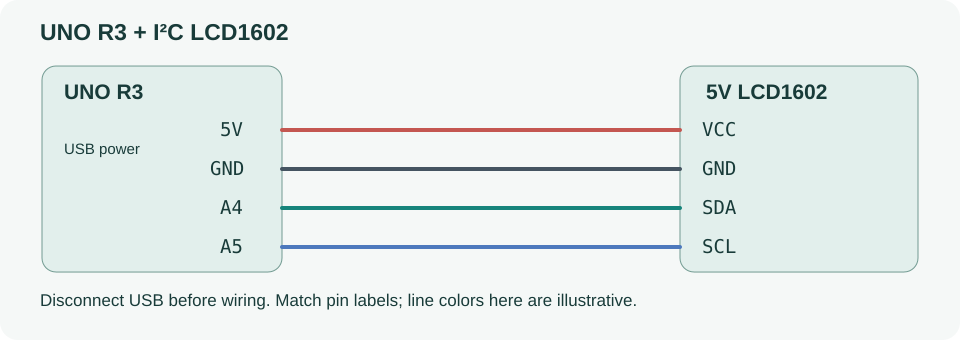

# Uno 表情屏

用独立的 Uno 和 I²C LCD1602 显示 toboo 的角色动画。Uno 在本地绘制双眼和嘴巴，上位机通过 USB 串口同步对话和本地视觉状态。运行传感器固件 `uno_sensors` 需要另一块板。

## 接线和使用

适用于 5V、四针 I²C LCD1602。先断开 USB，按模块丝印接线：

| LCD | Uno R3 |
| --- | --- |
| GND | GND |
| VCC | 5V |
| SDA | A4 / SDA |
| SCL | A5 / SCL |

此表不适用于未经确认的 3.3V 显示模块。Uno 通过 USB 供电；按标签识别引脚，不按线色。可缓慢调节转接板电位器改善对比度。



1. 按下文上传 Uno LCD 固件。上电即可看到待机双眼和周期性眨眼。
2. 在 toboo 的“设备 → 表情屏幕”选择 **Uno** 的 COM 口并连接。刚插入的设备可点“刷新”。打开串口时 Uno 会复位，连接需要几秒。
3. 在陪伴页输入消息并发送给 DeepSeek，观察角色的注意、思考和回应动画。需要视觉互动时，在设备页开启摄像头与本地表情识别。

| 角色状态 | 动画 | 触发条件 |
| --- | --- | --- |
| 待机 | 单眨、双眨，偶尔向两侧看 | 上电、没有有效线索，或连接超时 |
| 注意 | 短暂睁大眼睛，随后放松 | 正在输入，或相机检测到其他有效表情线索 |
| 思考 | 抬眼看向一侧、停顿、回到中间 | DeepSeek 已接收请求，正在生成文本 |
| 回应 | 嘴型大小交替，动作之间留有停顿 | 文本开始流式返回，结束后短暂延续 |
| 开心 | 弯眼微笑，轻轻上跳两次 | 回复结束，或相机检测到有效的开心线索 |

对话状态优先。桌面每 200ms 取一次最新状态，同一时刻只发送一条请求。Uno 收不到新状态时会在约 1.2 秒内回到待机，视觉线索按原有效期更早过期。陪伴页和设备页均可预览动画；设备页同时显示 Uno 连接状态。动作关键帧定义在 [LcdMotion.h](../firmware/uno_lcd/LcdMotion.h)，由桌面和 Uno 共用。

## 旧版表情模式

旧版桌面和已烧录旧版固件的 Uno 仍可使用以下颜文字。角色动画需要新版桌面和新版固件。

| 类别 | 第一行 | 第二行 |
| --- | --- | --- |
| 开心 | `(^_^)` | `happy` |
| 中性 | `(._.)` | `neutral` |
| 悲伤 | `(T_T)` | `sad` |
| 愤怒 | `(>_<)` | `angry` |
| 厌恶 | `(-_-)` | `disgust` |
| 恐惧 | `(O_O)` | `fearful` |
| 惊讶 | `(o_o)` | `surprised` |
| 等待 / 无效 | `(?)` | `No valid cue` |

旧版显示使用 ASCII。实时硬件线索来自启用表情识别的摄像头，界面的确认状态来自固件回复。

## 构建和上传

沿用 [隔离串口工具环境](../firmware/README.md)，固定 Arduino CLI 1.5.1、AVR core 1.8.6、pyserial 3.5。新增显示驱动 **hd44780 1.3.2**，仅安装到 `tmp/esp32-tools/user/libraries`，自动探测 I²C 地址和转接板映射。

```powershell
./tmp/esp32-tools/cli/arduino-cli.exe lib install hd44780@1.3.2 --config-file tmp/esp32-tools/arduino-cli.yaml
./scripts/build-uno-lcd.ps1
# COM7 只是示例：上传前确认实际 Uno 端口，并断开 toboo 屏幕连接。
./tmp/esp32-tools/cli/arduino-cli.exe upload --config-file tmp/esp32-tools/arduino-cli.yaml --fqbn arduino:avr:uno --port COM7 --input-dir artifacts/uno-lcd --verify
```

构建脚本运行纯 C++ 协议测试、Python 主机模拟测试并编译固件，不自动烧录。输出在忽略目录 `artifacts/uno-lcd`。实际串口验证会短暂显示七类表情，可显式运行：

```powershell
./tmp/esp32-tools/host/Scripts/python.exe firmware/tests/serial_lcd_test.py --port COM7 --out artifacts/uno-lcd/hardware-validation.json
```

测试记录区分真实 Uno 协议交互与光学显示检查。桌面使用内置 .NET 串口实现，便携包无需 Python 或源码目录。Python 工具仅用于可选的协议调试；源码启动入口为仓库根目录 `start-toboo.cmd`。

便携包的显式实物自检：`toboo.exe --lcd-self-test --lcd-port COM7`（端口以实际 Uno 为准，先断开已有屏幕连接）。自检只向屏幕发送 Unknown / neutral / Unknown 并核对回复，不启动摄像头或云台。

## 协议

115200、8N1、ASCII、LF。握手后查询动画能力，旧固件回复 `ERR` 时使用旧版表情命令。

```text
host: TOBOO_LCD?
UNO:  TOBOO_LCD,1,UNO,16,2
host: LCD_CAPS?
UNO:  LCD_CAPS,ROLE1
host: R,thinking,1200
UNO:  OK,R,thinking
```

`R,<role>,<ttl_ms>` 接受 `idle`、`attentive`、`thinking`、`responding`、`happy`，有效期为 1–1500ms。续发同一状态时继续播放当前动画。

```text
host: E,happy,300
UNO:  OK,happy
host: LCD_STATUS?
UNO:  LCD_STATE,happy
```

`E,<label>,<ttl_ms>` 只接受表中八个英文标签，ttl 为 1–500ms。上位机从结果 500ms 有效期中减去样本年龄和 50ms 传输余量，年龄不足时发送 Unknown；不会周期重发缓存的失效线索。非法行回复 `ERR`，不延长旧结果寿命。输入缓冲固定 40 字节，分片停顿 ≥100ms 丢弃到行尾。时间使用单调计时与 uint32 差值，覆盖 millis 回绕。

只有 LCD 初始化成功才返回握手。I²C 写失败回复 `TOBOO_LCD_ERROR,<code>`，需检查接线和复位；写成功不证明对比度或字符实际可见。PC 握手失败不发送显示命令，ACK 超时断开，屏幕连接不影响 ESP32 串口。

驱动来源：[hd44780](https://github.com/duinoWitchery/hd44780)。显示固件使用 GPL-3.0-or-later，详见 [许可](../licenses/hd44780-GPL-3.0.txt)；该依赖不链接到 .NET 桌面程序。
